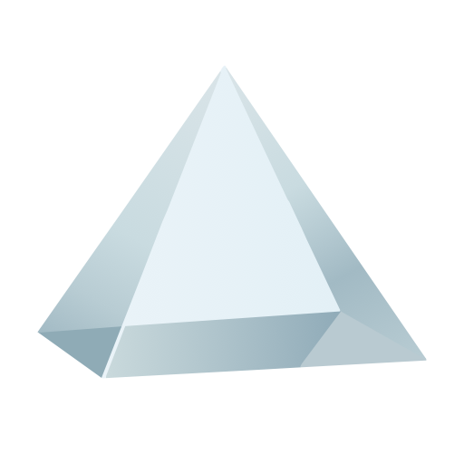
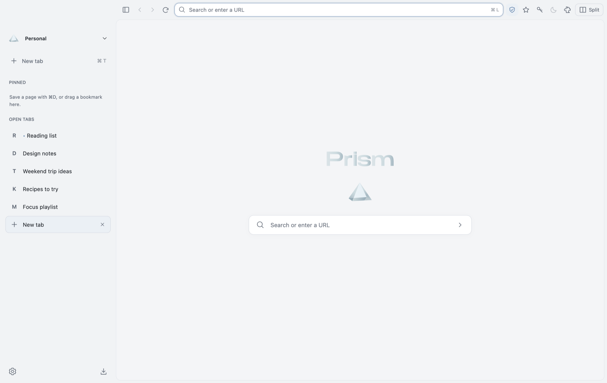
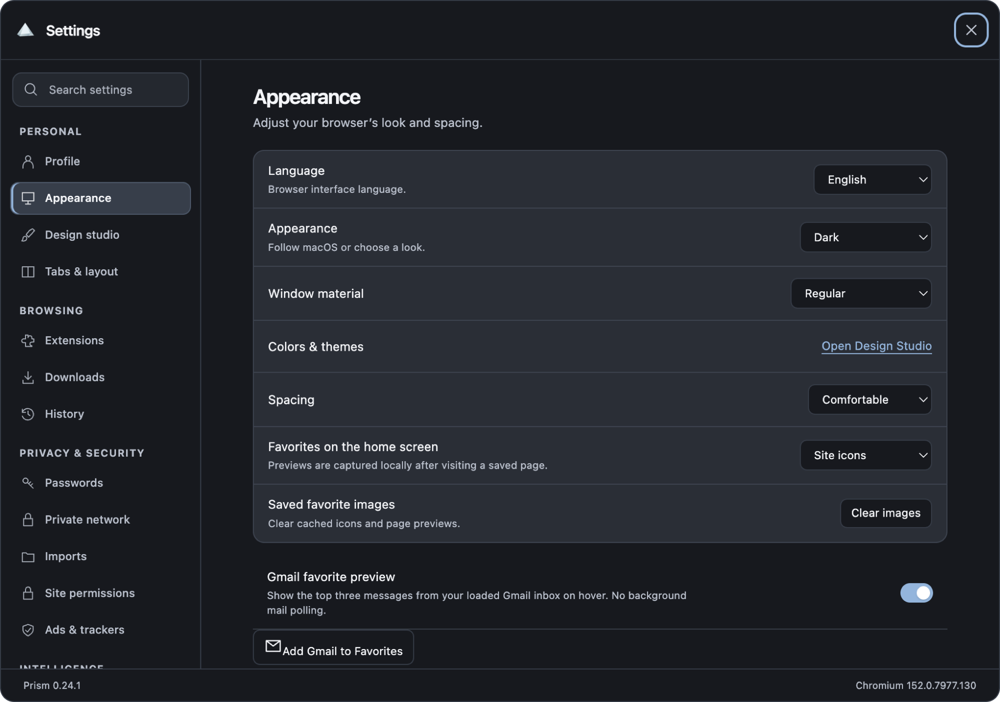

<div align="center">
  

  <h1>Prism</h1>

  **A liquid-glass Chromium browser for macOS, while keeping memory usage down.**

  <a href="https://github.com/batuarchv/Prism-Browser/releases/latest"><b>⬇︎ Download for Mac</b></a>
  &nbsp;·&nbsp; <a href="https://batuarchv.github.io/Prism-Browser/">Website</a>
  &nbsp;·&nbsp; <a href="CHANGELOG.md">What's new</a>

  <sub>Apple Silicon · macOS · free and open source (GPL-3.0)</sub>
</div>

<p align="center">
  <picture>
    <source media="(prefers-color-scheme: dark)" srcset="docs/screenshot-dark.png">
    
  </picture>
</p>

Prism is a personal browser project built on Electron and Chromium. Tabs live in a sidebar, the window is glass, and tabs you are not using go to sleep so they stop using memory. It's built in the open and changes often — expect rough edges.

## Features

- **Glass interface** — native macOS glass materials, light and dark, six colour themes and a design studio for your own.
- **Sidebar tabs** — pinned bookmarks and folders, favorites, inline rename, a right-click menu (duplicate, close others, add to folder…), one-click *Organize tabs by site*, and undo for anything you close or delete.
- **Sleeping tabs** — idle tabs sleep after a few minutes and wake when you click them; *Memory balance* lets you keep fewer tabs awake.
- **Split view** — two pages side by side or stacked.
- **Spaces** — Personal, Work and Private. Private uses a temporary session that is wiped when you end it.
- **Bypass censorship** in Private — routes Private tabs through the open-source [Zapret](https://github.com/bol-van/zapret) `tpws` helper (if installed) and looks sites up over encrypted DNS, for networks that block sites by DNS or traffic inspection. It is not a VPN.
- **Passwords** — an encrypted vault in your macOS Keychain, suggestions in sign-in fields, import a CSV exported from Apple Passwords, Chrome or other managers, copy and reveal with Touch ID. Prism never submits a form for you.
- **Extensions** — install from the Chrome Web Store; popups, options pages and extension windows work. Compatibility isn't identical to Chrome.
- **Built-in ad & tracker blocking**, a downloads manager, history, site permissions and a native share menu.
- **Page assistant** — summaries and selected-text translation with your own OpenAI key, previewed before anything is sent, and never in Private.
- **Returns you to apps** — when an app's sign-in page finishes, Prism asks before opening the app.
- **Six languages** — English, Türkçe, Español, Português, Français, Українська.
- **Automatic updates** — new versions come from this repository's releases, are checked against Prism's release signature, and install on the next launch.

<p align="center"></p>

## Install

1. Download **Prism-x.y.z.dmg** from the [latest release](https://github.com/batuarchv/Prism-Browser/releases/latest).
2. Open it and drag **Prism** into **Applications**.
3. The first time, **right-click (or Control-click) Prism in Applications → Open**, then **Open** again.
   Prism is not notarized by Apple yet, so macOS can't verify the developer and blocks a normal double-click the first time.

Prism needs an Apple Silicon Mac. Updates after that are automatic (Settings → Updates).

## Build from source

Requires macOS on Apple Silicon, [Node.js](https://nodejs.org) 22 or newer, [pnpm](https://pnpm.io) and the Xcode Command Line Tools.

```sh
git clone https://github.com/batuarchv/Prism-Browser.git
cd Prism-Browser
pnpm install
pnpm run prepare:extensions
pnpm start
```

```sh
pnpm test          # unit tests
pnpm run smoke     # end-to-end checks in a throwaway profile
pnpm run package   # build Prism.app into dist/
```

## Privacy

- Your profile, history, passwords and settings stay on your Mac. There is no Prism account or analytics.
- Passwords and payment cards are encrypted with your macOS Keychain; security codes are never stored.
- Private uses a separate in-memory session; its cookies and site data are gone when you end it.
- Update checks only download this repository's public release files.
- Optional AI features send text to OpenAI only after you add your own key and confirm.

## Contributing

Bug reports and small, focused pull requests are welcome — see [CONTRIBUTING.md](CONTRIBUTING.md).

## License

Prism is free software under the [GNU GPL v3](LICENSE). It is built on [Electron](https://www.electronjs.org) ([license](ELECTRON-LICENSE)) and Chromium; third-party components are listed in [THIRD-PARTY-NOTICES.md](THIRD-PARTY-NOTICES.md), with sources in `vendor-source/`. Prism is not affiliated with Google, Arc, Apple or OpenAI.

<sub>Made by [@batuarchv](https://github.com/batuarchv).</sub>
