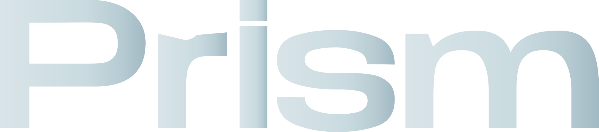

<div align="center">
  

  # Prism

  **Chromium, refracted.**

  An experimental macOS browser exploring native Liquid Glass, calmer tab management, and privacy-minded browsing.

  [Project site](https://batuarchv.github.io/Prism-Browser/) · [Source](https://github.com/batuarchv/Prism-Browser) · [Releases](https://github.com/batuarchv/Prism-Browser/releases)
</div>

<p align="center"></p>

## About

Prism is a personal open-source browser prototype built on Electron and Chromium for Apple Silicon Macs. It experiments with macOS native glass materials and a browser layout that gives tabs and everyday tools more room.

This project is experimental and changes frequently. It is not affiliated with Arc, Chromium, or OpenAI.

## What it includes

- Native macOS Liquid Glass materials, with a frosted-glass fallback and controls for appearance and accessibility.
- Personal, Work, and Private spaces. Private browsing uses a separate in-memory Chromium session and clears its session data when the private space ends.
- Sleeping tabs that release their page renderer after inactivity and restore when reopened.
- A Chromium extension compatibility layer, downloads manager, ad blocking, bookmarks, and browsing history.
- A local encrypted password vault with origin-restricted filling. Prism never submits a login form for you.

Extension support is not identical to Chrome. Apple Passwords integration, passkey syncing, and live profile synchronization are not provided. Memory use depends on the sites and workload; there is no measured Arc comparison or claim that Prism optimizes the Chromium engine.

## Download

When packaged builds are published, they will appear on [GitHub Releases](https://github.com/batuarchv/Prism-Browser/releases). Prism currently targets macOS on Apple Silicon. Builds are experimental and are not notarized for broad distribution.

## Build from source

Requirements: macOS on Apple Silicon, Node.js 22 or newer, pnpm, and Xcode Command Line Tools.

```sh
git clone https://github.com/batuarchv/Prism-Browser.git
cd Prism-Browser
pnpm install
pnpm run prepare:extensions
pnpm start
```

To package a macOS app:

```sh
pnpm run package
```

The package is written to `dist/Prism-darwin-arm64`. On macOS, packaging can reuse the Electron runtime installed by `pnpm install`; otherwise it may need network access to download that runtime.

Optional native development commands:

```sh
pnpm run build:native # rebuild the AppKit glass bridge
pnpm run build:ai     # rebuild the optional Swift helper; requires the macOS 26 SDK
```

## GitHub Pages

The static project site lives in [`site/`](site/). A GitHub Actions workflow publishes it when changes are pushed to `main`. In the repository settings, set **Pages → Build and deployment → Source** to **GitHub Actions**.

## Privacy and security

Browser data stays in the local Prism profile. Private sessions are isolated from normal browsing. Prism's password vault uses Electron safeStorage backed by macOS Keychain. The project does not claim a complete security boundary against a compromised operating system, malicious extensions, or every Chromium vulnerability. Keep Prism and its Electron runtime updated, and use extensions you trust.

Please report security issues privately to the repository owner rather than posting exploit details in a public issue.

## Contributing

Issues and pull requests are welcome. Before opening a pull request, describe the change and its user-visible effect. Avoid including personal browsing data, credentials, profile directories, local logs, or unredacted screenshots.

## License

Prism is distributed under the [GNU General Public License v3.0 only](LICENSE). Third-party notices are in [THIRD-PARTY-NOTICES.md](THIRD-PARTY-NOTICES.md).
